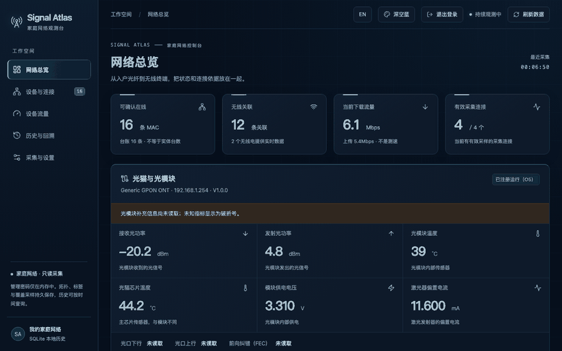
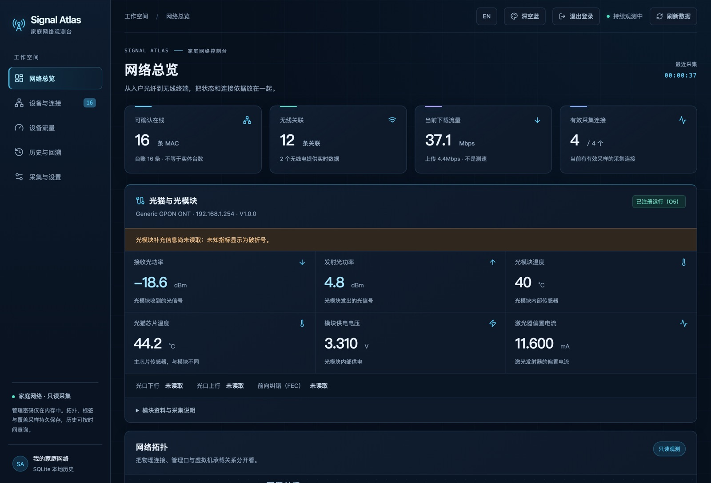
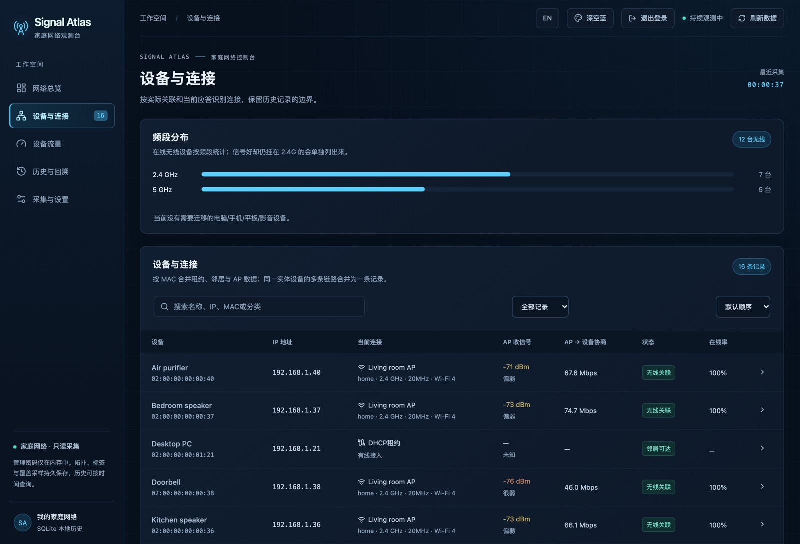
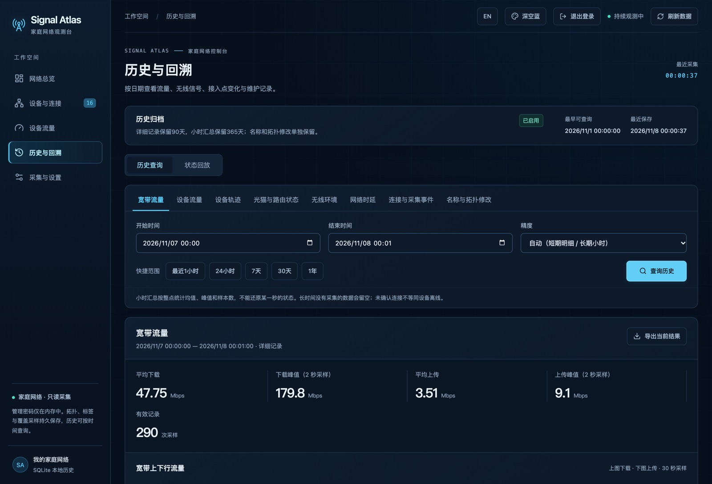
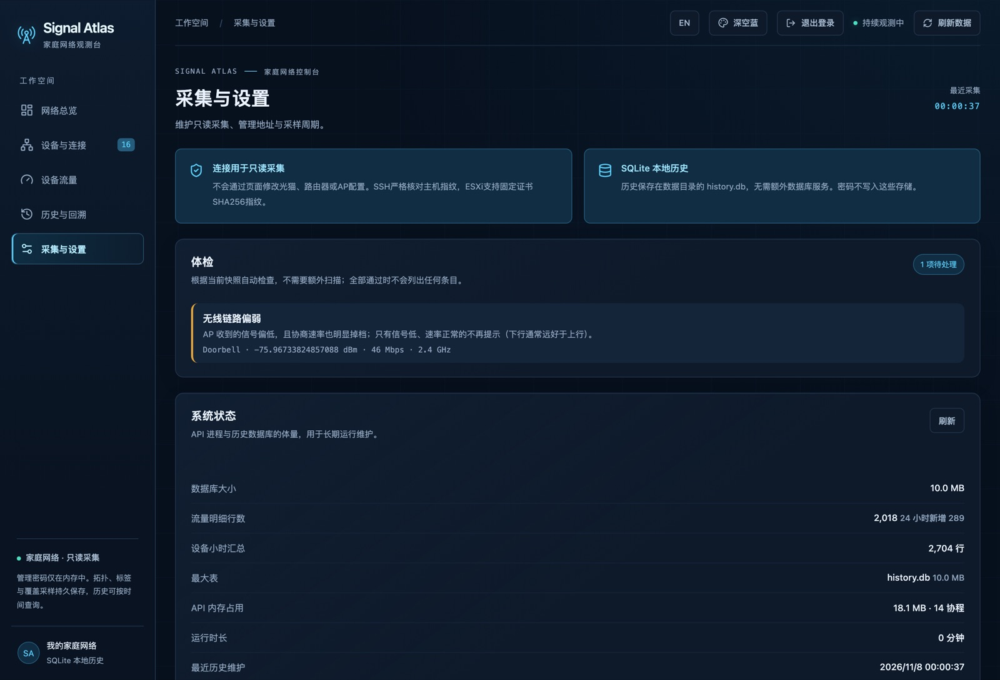

<div align="center">

# Signal Atlas

**A read-only home network observatory.**

See what your network is actually doing — devices, traffic, signal and history —
without ever changing a device setting.

[](https://github.com/spongeBor/signal-Altas/actions/workflows/ci.yml)
[](LICENSE)
[](api/go.mod)
[](.nvmrc)

[Quick start](#quick-start) · [Try demo](#try-it-without-hardware) · [What you get](#what-you-get) · [Configuration](#configuration)



</div>

## Quick start

```sh
git clone https://github.com/spongeBor/signal-Altas.git
cd signal-Altas
./deploy.sh
```

The script builds the image, starts it, and prints a URL plus a generated password.
Open the page, go to **Collectors → scan this network**, add your router and AP — done.

Requirements: Docker with Compose v2, and SSH access to the devices you want to watch.
Nothing is written to them.

### Try it without hardware

```sh
./deploy.sh --demo
```

Starts with 16 synthetic devices, four collectors and a week of history, so you can
click around before touching a real router.

## What you get

| | |
|---|---|
| **Devices** | Every phone, TV and light bulb — IP, SSID, band, width, signal, negotiated rate, Wi-Fi generation (4/5/6/7) and MLO links. |
| **Traffic** | Current WAN speed, a true 60-second peak from SNMP, and per-device usage from the router's counters. |
| **History** | 60 days of 30-second detail plus a year of hourly rollups: traffic, device tracks, wireless environment, latency, events. |
| **Health** | Failed collectors, weak links, duplicate addresses, stale ledger entries — computed from the live snapshot. |
| **Setup** | Scan the LAN, identify each host, approve its SSH fingerprint in the browser. No terminal needed. |

| Overview | Devices |
|---|---|
|  |  |

| History | Collectors |
|---|---|
|  |  |

## How it works

One Go binary serves the web UI and the API. Every 30 seconds it reads a handful of
read-only commands from each device, merges them into a single view, and stores history
in a local SQLite file. PostgreSQL is optional.

```
collectors ──► engine ──► SQLite history ──► web UI (embedded)
   SSH / Telnet / SNMP / HTTPS        documents: config, labels, topology
```

Supported today: **OpenWrt** routers, **ASUS** routers and AiMesh nodes, **VMware ESXi**,
ZTE-style **ONTs** over Telnet, and plain **TCP** checks for switches.

## Configuration

`config.yaml` is optional; environment variables win.

| Field | Meaning | Default |
|---|---|---|
| `listen` | HTTP address | `127.0.0.1:8790` |
| `lan_cidr` | range used by discovery | inferred from known devices |
| `interval_seconds` | collection period | 30 |
| `retention.detail_days` / `summary_days` | history retention | 60 / 365 |
| `snmp.host` / `interface` | WAN peak sampling | — / `pppoe-wan` |
| `ping_targets` | latency probes (run from the router) | gateway, AP, two DNS |

Secrets live in `.env`: `SIGNAL_ATLAS_WEB_USER`, `SIGNAL_ATLAS_WEB_PASSWORD`,
`SIGNAL_ATLAS_SNMP_COMMUNITY`, optional `DATABASE_URL`.

## Without Docker

```sh
npm ci && npm run build --workspace @signal-atlas/web
cp -r web/dist/. api/internal/webui/dist/
go -C api build -o ../signal-atlas ./cmd/server
SIGNAL_ATLAS_WEB_USER=admin SIGNAL_ATLAS_WEB_PASSWORD='at-least-16-chars' \
  ./signal-atlas -addr 0.0.0.0:8768 -data-dir ./data
```

More: [architecture](docs/architecture.md) · [history model](docs/history.md) · [deployment](docs/deployment.md).

## Development

```sh
npm ci
npm run dev                  # web on 5173, API on 8790
go -C api test ./...
```

Go 1.26, Node.js 24. MIT license — see [LICENSE](LICENSE).

中文说明：[README.zh-CN.md](README.zh-CN.md)
