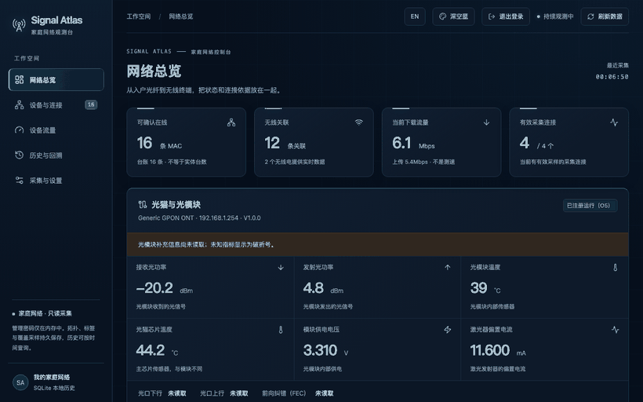
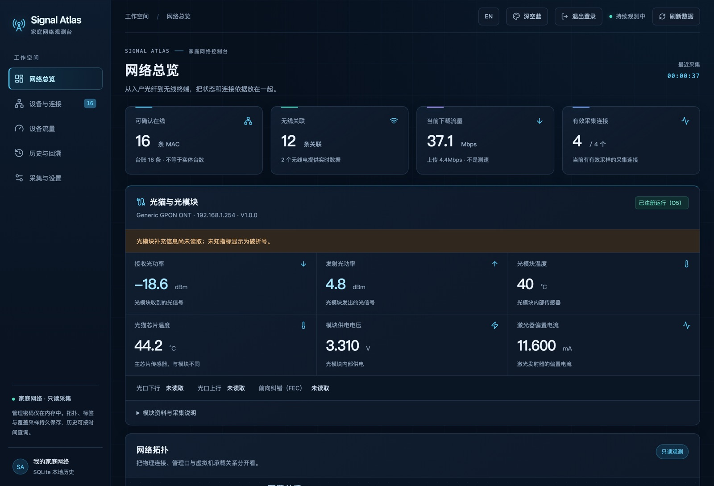
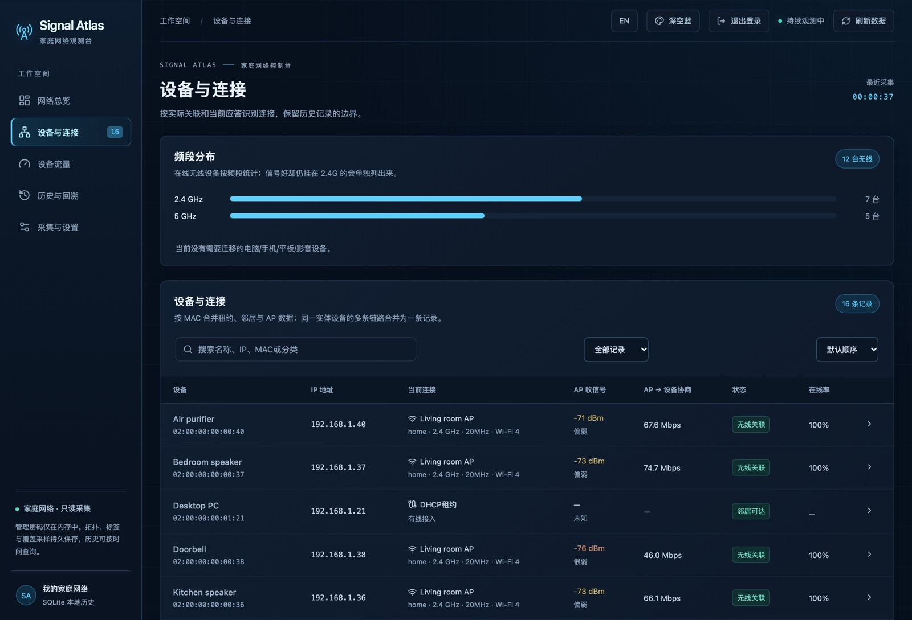
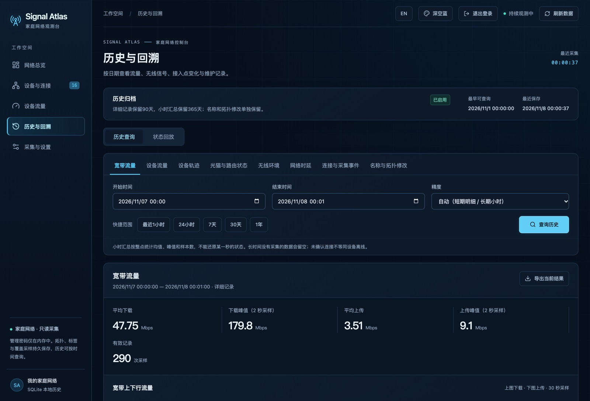
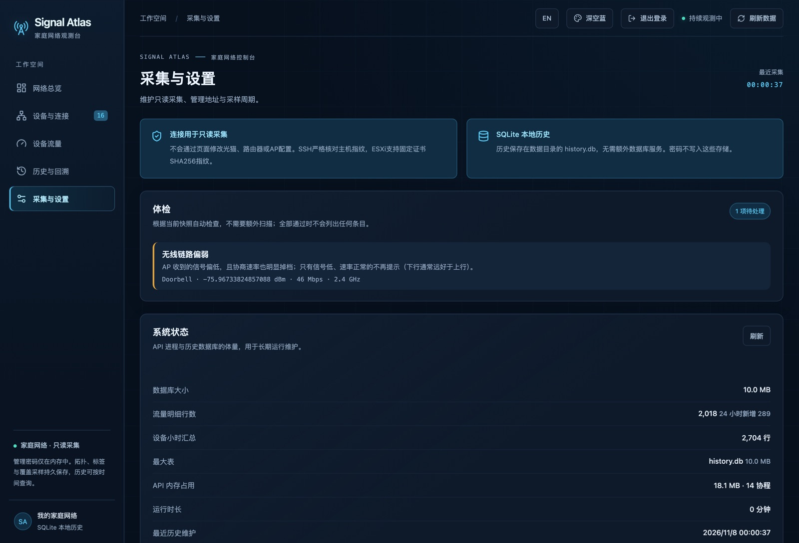

<div align="center">

# Signal Atlas

**只读的家庭网络观测台。**

看清网络实际在做什么——设备、流量、信号和历史——但从不修改任何设备设置。

[](https://github.com/spongeBor/signal-Altas/actions/workflows/ci.yml)
[](LICENSE)
[](api/go.mod)
[](.nvmrc)

[快速开始](#快速开始) · [演示](#没有设备先看演示) · [能看到什么](#能看到什么) · [配置](#配置)



</div>

## 快速开始

```sh
git clone https://github.com/spongeBor/signal-Altas.git
cd signal-Altas
./deploy.sh
```

脚本会构建镜像、启动服务，并打印访问地址和随机生成的密码。
打开页面后到「采集与设置 → 扫描本网段」，添加路由器和 AP 就能用。

要求：Docker（Compose v2），以及目标设备的管理账号。采集全程只读。

### 没有设备，先看演示

```sh
./deploy.sh --demo
```

自带 16 台合成设备、4 个采集器和一周历史，打开就能点，不用先接真实路由器。

## 能看到什么

| | |
|---|---|
| **设备** | 手机、电视、灯泡——IP、Wi-Fi 名称、频段、带宽、信号、协商速率、Wi-Fi 代际（4/5/6/7）和 MLO 链路。 |
| **流量** | 当前网速、来自 SNMP 的真实 60 秒峰值、每台设备的用量。 |
| **历史** | 60 天 30 秒明细 + 一年小时汇总：流量、设备轨迹、无线环境、时延、事件。 |
| **体检** | 采集失败、链路偏弱、地址冲突、过期台账——都基于当前快照实时计算。 |
| **配置** | 扫描网段、识别设备类型、在浏览器里确认 SSH 指纹，不需要打开终端。 |

| 总览 | 设备 |
|---|---|
|  |  |

| 历史 | 采集与设置 |
|---|---|
|  |  |

## 工作方式

一个 Go 程序同时提供网页和接口。每 30 秒用只读命令读取各设备，合并成一份视图，
历史写进本地 SQLite 文件。PostgreSQL 是可选项。

```
采集器 ──► 引擎 ──► SQLite 历史 ──► 内嵌网页
  SSH / Telnet / SNMP / HTTPS        配置、标签、拓扑
```

目前支持：**OpenWrt** 路由、**ASUS** 路由与 AiMesh 节点、**VMware ESXi**、
ZTE 系 **光猫**（Telnet），以及交换机的 **TCP** 端口探测。

## 配置

`config.yaml` 可选，环境变量优先。

| 字段 | 含义 | 默认 |
|---|---|---|
| `listen` | 监听地址 | `127.0.0.1:8790` |
| `lan_cidr` | 自动发现扫描的网段 | 由已知设备推断 |
| `interval_seconds` | 采集周期 | 30 |
| `retention.detail_days` / `summary_days` | 历史保留 | 60 / 365 |
| `snmp.host` / `interface` | 峰值采样 | — / `pppoe-wan` |
| `ping_targets` | 时延探测目标 | 网关、AP、两个 DNS |

密钥放在 `.env`：`SIGNAL_ATLAS_WEB_USER`、`SIGNAL_ATLAS_WEB_PASSWORD`、
`SIGNAL_ATLAS_SNMP_COMMUNITY`，需要时再加 `DATABASE_URL`。

## 不用 Docker

```sh
npm ci && npm run build --workspace @signal-atlas/web
cp -r web/dist/. api/internal/webui/dist/
go -C api build -o ../signal-atlas ./cmd/server
SIGNAL_ATLAS_WEB_USER=admin SIGNAL_ATLAS_WEB_PASSWORD='至少16位密码' \
  ./signal-atlas -addr 0.0.0.0:8768 -data-dir ./data
```

更多：[架构](docs/architecture.md) · [历史模型](docs/history.md) · [部署](docs/deployment.md)。

## 开发

```sh
npm ci
npm run dev                  # 网页 5173，接口 8790
go -C api test ./...
```

Go 1.26、Node.js 24。MIT 协议，见 [LICENSE](LICENSE)。

English: [README.md](README.md)
